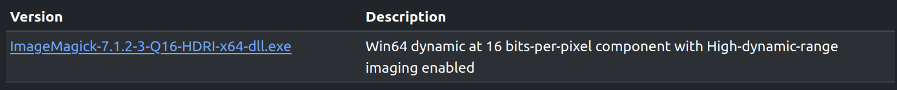
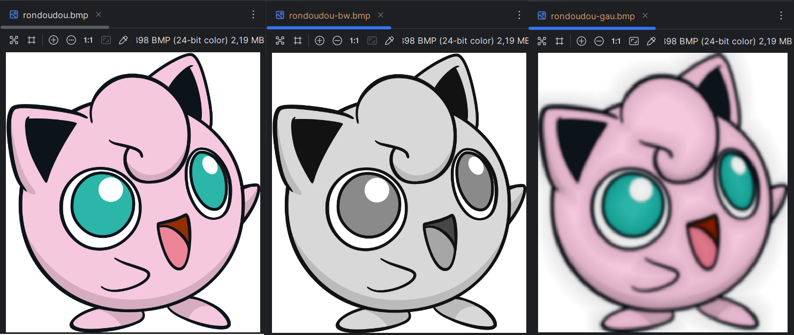
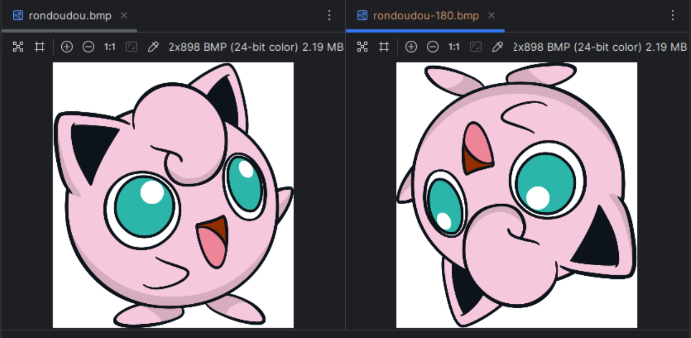

# DAI WORK 1 - éditeur de fichier BMP


## Introduction
Cette application en ligne de commande (CLI) permet de lire une image au format .bmp, de lui appliquer une transformation (filtre ou rotation), puis de l’enregistrer dans un nouveau fichier.

## Table des matières
- [Introduction](#introduction)
- [Table des matières](#table-des-matières)
- [Clone et Build](#clone-et-build)
- [Utilisation](#utilisation)
  - [Contexte](#contexte)
  - [Version du fichier](#version-du-fichier)
  - [Exemple d'utilisation](#exemple-dutilisation)
- [Auteurs](#auteurs)

## Clone et Build
Les étapes suivantes vous permettent de cloner et build le projet afin de pouvoir commencer à l'utiliser. Nous utilisons Maven comme gestionnaire de projet.

Cloner le repo
```
git clone git@github.com:QuentinMichon/dai-work-1.git
```

Rentrer dans le dossier racine
```
cd work-1-BMP-cli/
```

#### Pour Linux / MacOS
Télécharger les dépendances 
```sh
./mvnw dependency:go-offline
```
Générer une archive JAR
```sh
./mvnw clean package
```

#### Pour Windows
Télécharger les dépendances
```sh
./mvnw.cmd dependency:go-offline
```
Générer une archive JAR
```sh
./mvnw.cmd clean package
```

> [!NOTE]
> 
> Si vous utilisez l'IDE Intellij IDEA, vous pouvez run la configuration **Package application as JAR file** afin d'automatiser la création de l'archive.

## Utilisation

### Contexte
Le programme va lire une image au format .bmp puis y appliquer les transformations demandée. Pour finir, il écrit la nouvelle image dans un nouveau fichier. Trois images vous sont fournies afin de faire des tests :
- rondoudou.bmp
- pokeball.bmp
- salameche.bmp

>[!CAUTION]
> 
> Si vous utilisez l'IDE Intellij IDEA, vous trouverez des configurations d'exécution pour tester simplement les différentes fonctionnalités. Les images sont écrites et lues dans le dossier [IOFile](IOFile).

### Version du fichier
Le programme peut gérer qu'un type de fichier avec les caractéristiques suivantes : 
- Type : BMP3 (Microsoft Windows bitmap image V3) 
- Colorspace : sRGB
- Depth : 8-bits (par canal)

### Convertir un .png en .bmp

Pour s'assurer de la bonne compatibilité des fichiers utilisés, vous pouvez suivre les étapes suivantes pour convertir une image .png en .bmp utilisable par le programme.

#### Linux / MacOS
1) Installer ImageMagick
```sh
sudo apt install imagemagick 
```
2) Vérifier l'installation
```sh
convert --version
```
3) Convertir l'image PNG en BMP

```sh
convert rondoudou.png -background white -alpha remove -alpha off -type TrueColor +profile "*" BMP3:rondoudou.bmp
```

#### Windows
1) Télécharger le binaire officiel : ImageMagick Download


2) Pendant l’installation, cocher l’option "Add application directory to your system path" pour pouvoir utiliser magick dans l’invite de commande.

3) Vérifier l'installation
```sh
magick -version
```
4) Convertir l'image PNG en BMP
```
magick rondoudou.png -background white -alpha remove -alpha off -type TrueColor +profile "*" BMP3:rondoudou.bmp
```

>[!NOTE]
> 
> Cette commande remplace un fond transparent par un fond blanc.

>[!NOTE]
> 
> Vous trouverez une [image](IOFile/rondoudou.png) au format .png pour tester la conversion au format .bmp

### convertir un .jpg en .bmp
Avec convert (magic sous windows) il est également possible de convertir un .jpg en .bmp (pour l'installation et magic/convert, se référer aux premières étapes du [point précédent](#convertir-un-png-en-bmp)).

#### Linux / MacOS 

```convert /chemin/input.jpg -depth 8 -colorspace sRGB bmp3:/chemin/output.bmp```

#### Windows

```makick /chemin/input.jpg -depth 8 -colorspace sRGB bmp3:/chemin/output.bmp```

### Exemple d'utilisation
L'archive .jar se trouve dans le fichier [target/](target/work-1-BMP-cli-1.0-SNAPSHOT.jar). Ouvrez un terminal dans ce dossier afin de pouvoir exécuter les commandes suivantes.

#### Commandes disponibles
- [**Copie simple**](#Copier-coller) : copie le fichier source vers un nouveau fichier.
- [**Filter**](#Filtre) : applique un filtre (-f est obligatoire).
- [**Rotation**](#Rotation) : applique une rotation (-r est obligatoire).


#### Copier-coller
Le programme de base permet de copier-coller une image. Le premier paramètre est le nom du fichier source et le deuxième le nom du fichier de destination.

```
java -jar target/work-1-BMP-cli-1.0-SNAPSHOT.jar \
/chemin/vers/rondoudou.bmp \
/chemin/vers/rondoudou-copy.bmp
```
#### Filtre
La commande **filter** applique un filtre à l'image. L'option -f est obligatoire et permet de choisir le type de filtre (BLACK_WHITE ou GAUSSIAN).

```
java -jar target/work-1-BMP-cli-1.0-SNAPSHOT.jar \
/chemin/vers/rondoudou.bmp \
/chemin/vers/rondoudou-bw.bmp \
filter -f=BLACK_WHITE
```

```
java -jar target/work-1-BMP-cli-1.0-SNAPSHOT.jar \
/chemin/vers/rondoudou.bmp \
/chemin/vers/rondoudou-gau.bmp \
filter -f=GAUSSIAN
```




#### Rotation
La commande rotation applique une rotation de l’image dans le sens horaire. L’option -r est obligatoire et permet de choisir l’angle (ROTATE_90, ROTATE_180, ROTATE_270).

```
java -jar target/work-1-BMP-cli-1.0-SNAPSHOT.jar \
/chemin/vers/rondoudou.bmp \
/chemin/vers/rondoudou-180.bmp \
rotation -r=ROTATE_180
```



## Auteurs
- [Quentin Michon](https://github.com/QuentinMichon)
- [Gianni Bee](https://github.com/GinByte)

Avec l’aide de Copilot pour la rédaction des en-têtes de fonctions.